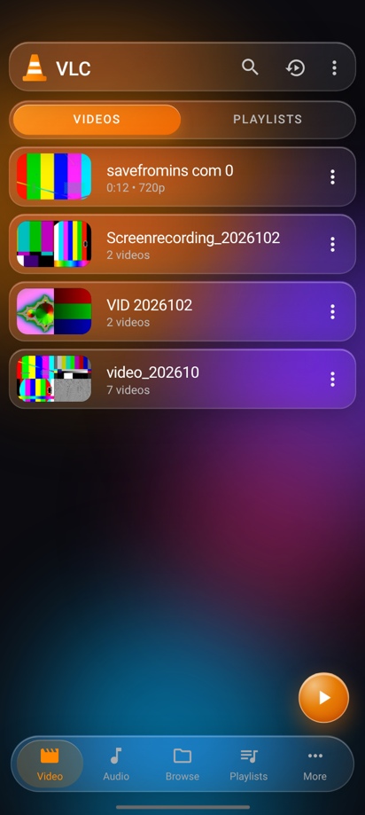
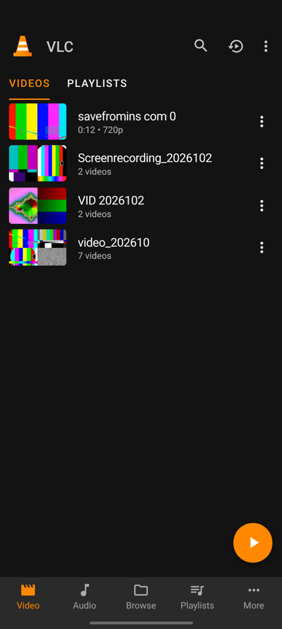

# 🎬 VLC Clone — Video Player (Tech Bro Z)

**Educational clone, not affiliated with VideoLAN.** “VLC” and the traffic-cone belong to VideoLAN — ye ek personal learning project hai jo VLC for Android ki video screen ka look copy karta hai. The cone logo here is drawn from scratch as SVG.

🔗 **Live:** https://vlc-clone-techbroz.sites.tab.bot  
🔗 **GitHub Pages:** https://nm621532-byte.github.io/vlc-clone-techbroz/

| Original VLC screenshot vs Clone (Classic) vs Clone (Liquid Glass) |
|---|
|  |

 

## 🔒 Privacy (sab kuch phone pe)
- **No server, no account, no upload.** Videos, thumbnails, playlists, history and settings stay **only in your own browser** (IndexedDB + localStorage).
- There is no server-side user data at all, so no one else can ever see your library (no IDOR possible — there are no IDs on any server).
- “Clear library” (More tab) deletes everything from this app. Your original files on the phone are never touched.

## ✨ Features
**Library (VLC jaisa):**
- Add videos from your phone (`Add videos` – multiple files at once), real **thumbnails** made from the video (canvas frame grab), real **duration + resolution** (e.g. `0:12 • 720p`)
- **Group by name** → folders like “7 videos” with 2×2 mosaic thumbnails (can be turned off)
- **Search**, **sort** (name / date / length / size, ↑↓), **grid / list** view
- 3-dot menu per item: Play, Play from start, Add to playlist, Favorites, Rename (in-app), Information, Remove (with Undo)
- **Playlists** (create, rename, delete, add videos/folders, reorder, play all, shuffle)
- **Favorites**, **playback history**, **resume** (history icon reopens the last video at its last position), progress bar on thumbnails
- **Audio tab** for songs (MP3/M4A/WAV/OGG…) with spinning disc art
- Library **persists after reload** (files are saved in IndexedDB; if the phone refuses to store a big file, the app asks you to pick it again)
- Orange **FAB** plays the last video (or the first one)
- **Liquid Glass** (iOS-26 style frosted glass, default) or **Classic** (exact VLC look) • **Dark / Light** theme

**Player:**
- Play/pause, seek bar, time, **±10 s**, previous / next, **speed 0.25×–4×**
- **Gestures:** swipe left side = brightness, right side = volume, horizontal swipe = seek, **double-tap** left/right = ±10 s
- **A-B repeat**, **loop one / all**, **shuffle**, **sleep timer** (5 min…1 h / end of video)
- **Subtitles**: load `.srt` / `.vtt` (SRT is converted to VTT in JavaScript), on/off, 4 sizes, saved with the video
- **Equalizer** (5 bands + presets: Bass boost, Pop, Rock, Vocal, Treble, Classical) and **audio boost up to 200%** (Web Audio API)
- **Picture-in-picture**, **screenshot** of the current frame (downloads PNG), **aspect ratio** (fit / fill / stretch / 16:9 / 4:3), **rotate**, **fullscreen**, **lock** controls
- **Mini player** when you leave the player, **background audio** setting, lock-screen controls (Media Session)
- **Keyboard shortcuts** (laptop): Space/K play, ←/→ or J/L ±10 s, ↑/↓ volume, M mute, F fullscreen, [ ] speed, N/B next/prev, S screenshot, P PiP, A A-B repeat, Esc close, / search

## ▶️ Kaise chalayein (How to run)
1. **Easiest:** open the live link on your phone → ⋮ → **Add videos**.
2. **Offline / local:** download the ZIP (Code → Download ZIP), unzip, open `index.html` in Chrome.  
   (Some phones block video features on `file://`; then use step 3.)
3. **Local server:** `python3 -m http.server 8000` in this folder → open http://localhost:8000
4. **GitHub Pages:** already enabled → https://nm621532-byte.github.io/vlc-clone-techbroz/

## 🛠️ Kaise edit karein (How to edit)
| File | Kya hai |
|---|---|
| `index.html` | Structure: toolbar, tabs, list, FAB, bottom nav, player, sheets |
| `style.css` | Look: Classic VLC sizes/colors (top), Light theme, **Liquid Glass** section (bottom) |
| `app.js` | Logic: IndexedDB storage, thumbnails, grouping, menus, player, gestures, EQ, subtitles |

- Orange color change karna hai? `style.css` → `--orange:#ff8800`
- Default style Classic karna hai? `app.js` → `DEF = { style: 'glass' ...` → `'classic'`
- Naya EQ preset? `app.js` → `PRESETS`
- URL tricks: `?style=classic`, `?theme=light`, `?nav=audio`

## ✅ Tests (run before every publish)
```bash
node --test test/site.test.mjs                       # static checks (no install needed)
pip install playwright && playwright install chromium
python3 -m http.server 8765 &                        # serve this folder
python3 test/smoke_test.py http://127.0.0.1:8765/ ./testmedia classic   # 80 feature checks
```
`testmedia/` = a few small mp4 files + one mp3 + `test.srt` (make them with ffmpeg, see the top of `smoke_test.py`).

## 📄 License
MIT — see [LICENSE](LICENSE). Icons are original SVG / Material-style paths (Apache-2.0). Not affiliated with, endorsed by, or connected to VideoLAN.

---
Made by **Tech Bro Z** — YouTube [@techbrozdeveloper](https://www.youtube.com/@techbrozdeveloper) • Instagram [@tech_bro_z_1](https://www.instagram.com/tech_bro_z_1/)
