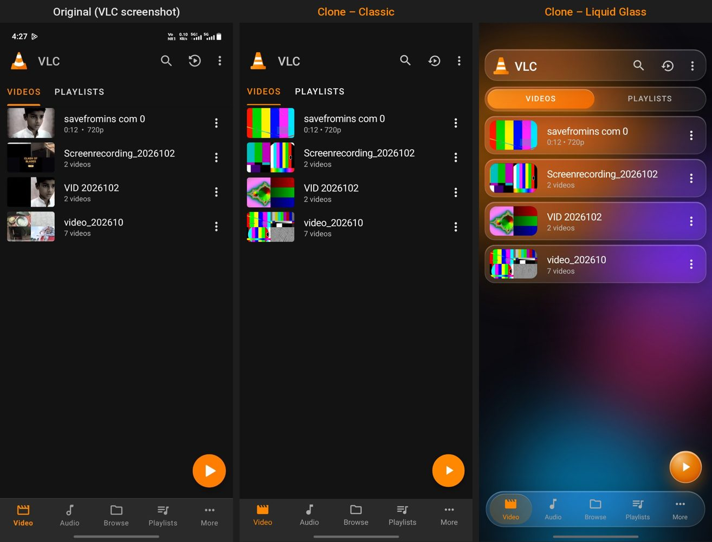
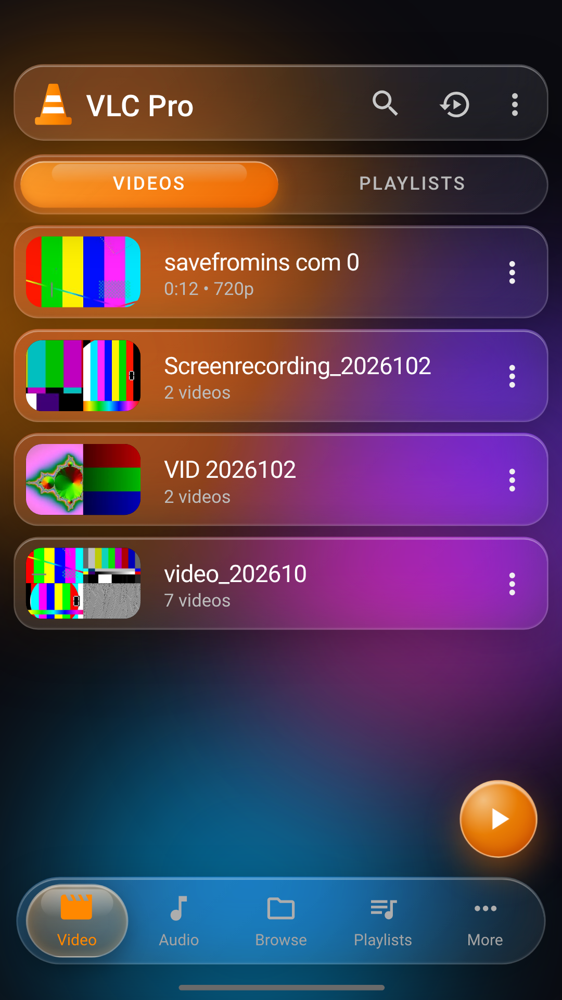
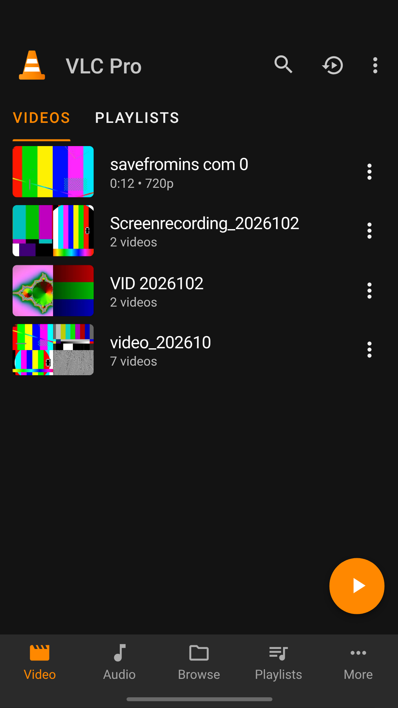
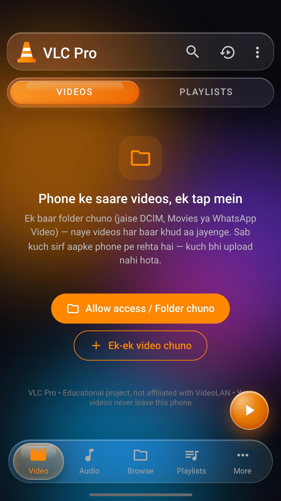
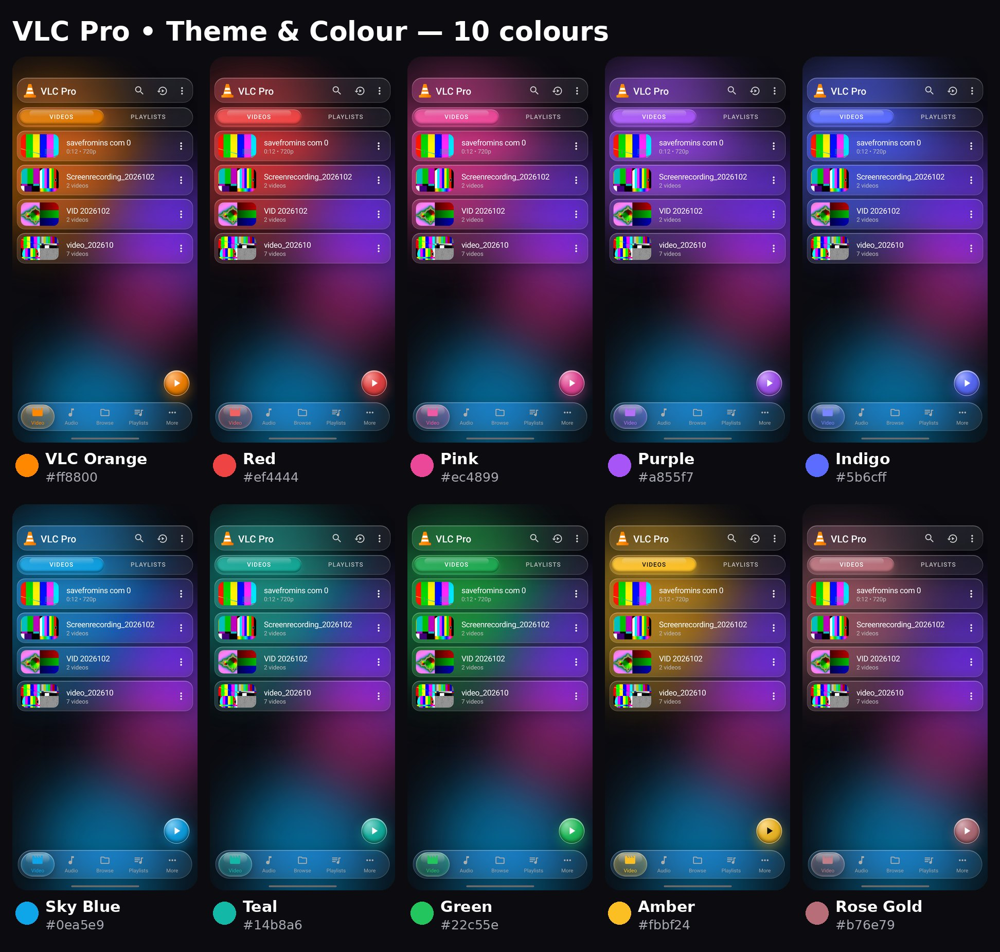
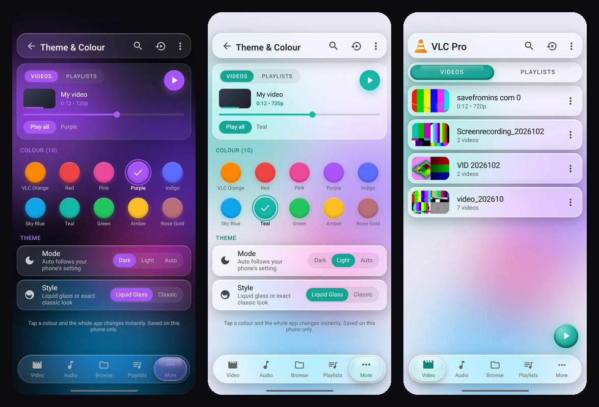
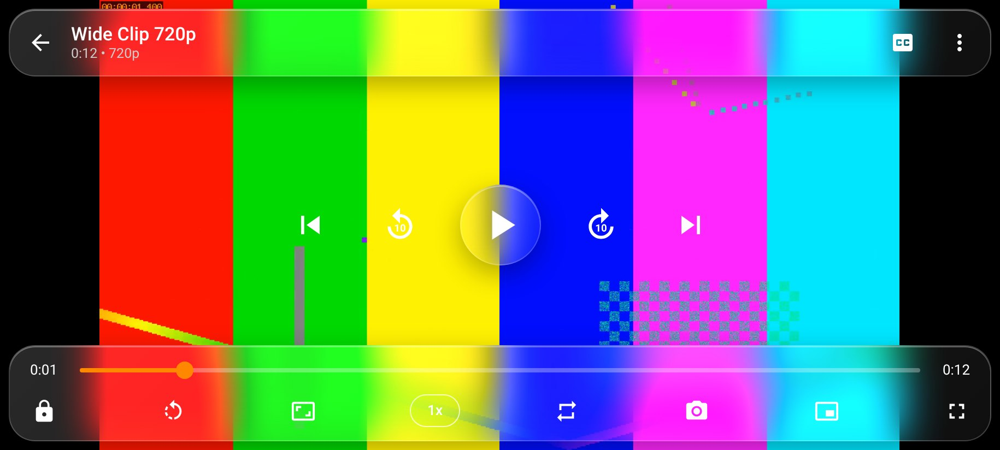

# 🎬 VLC Pro — Video Player (Tech Bro Z)

**Educational project, not affiliated with VideoLAN.** “VLC” and the traffic-cone belong to VideoLAN — VLC Pro ek personal learning project hai jo VLC for Android ki video screen se inspired hai. The cone logo here is drawn from scratch as SVG.

🔗 **Live:** https://vlc-pro-techbroz.sites.tab.bot  
🔗 **GitHub Pages:** https://nm621532-byte.github.io/vlc-pro-techbroz/

| Original VLC screenshot vs VLC Pro (Classic) vs VLC Pro (Liquid Glass) |
|---|
|  |

  

🎞️ Liquid tab animation demo: [screenshots/vlc_pro_tabs.mp4](screenshots/vlc_pro_tabs.mp4)

## 📱 Android APK install kaise karein

VLC Pro ab **Android app** bhi hai — install karte hi phone ke saare videos folder-wise khud aa jaate hain (DCIM, Camera, Movies, WhatsApp Video…), ek-ek add karne ki zarurat nahi.

1. **Download karo:** [VLC-Pro.apk](https://github.com/nm621532-byte/vlc-pro-techbroz/releases/download/v1.0/VLC-Pro.apk) (GitHub Release v1.0) ya https://vlc-pro-techbroz.sites.tab.bot/VLC-Pro.apk
2. **Unknown sources allow karo:** file kholte hi phone poochhega "Install unknown apps" → us app (Chrome / Files / WhatsApp) ke liye **Allow from this source** on karo → wapas aao.
3. **Install** dabao. (Play Protect "unknown app" bole to *More details → Install anyway* — app Play Store pe nahi hai isliye.)
4. **Open karo** → screen aayegi "Saare videos dikhane ke liye permission do" → **Permission do** → **Allow**.
5. Bas! Saare videos folder-wise aa jayenge. Naye videos ke liye app kholo ya list ko neeche kheencho (pull-to-refresh).

- Android 7.0 se Android 14+ tak chalta hai. Size ~3 MB.
- App mein INTERNET permission hi nahi hai — aapke videos aur data sirf aapke phone pe rehte hain.
- Android app ka code: [`android/`](android/) folder.

## 🎨 Theme & Colour (10 colours)


- **Kahan milega:** More tab → **Theme & Colour** (ya ⋮ menu → Theme & Colour).
- **Mode:** Dark / Light / **Auto** (Auto = phone ki dark/light setting follow karta hai, live).
- **Style:** Liquid Glass / Classic.
- **10 colours** — tap karte hi poora app us colour mein smoothly badal jaata hai (tab pill, liquid blob, buttons, play button, seek bar, progress, icons). Logo ka cone orange hi rehta hai (brand).

| Colour | Hex |
|---|---|
| VLC Orange (default) | `#ff8800` |
| Red | `#ef4444` |
| Pink | `#ec4899` |
| Purple | `#a855f7` |
| Indigo | `#5b6cff` |
| Sky Blue | `#0ea5e9` |
| Teal | `#14b8a6` |
| Green | `#22c55e` |
| Amber | `#fbbf24` |
| Rose Gold | `#b76e79` |

- **Readable hamesha:** colour ke upar text ka colour khud chuna jaata hai (white ya dark, kam se kam 3:1 contrast — jaise Amber pe dark text), aur page pe colour wala text Dark/Light dono mein kam se kam 4.5:1 contrast tak adjust hota hai.
- **No flash:** `theme.js` `<head>` mein CSS se pehle chalta hai, isliye reload pe pehle frame se hi aapka colour dikhta hai. PWA `theme-color` bhi colour ke saath badalta hai.
- **Sirf aapke phone pe save** (localStorage). URL se sirf ye 10 values chalti hain: `?accent=orange|red|pink|purple|indigo|sky|teal|green|amber|rosegold` (preview only, save nahi hota); koi aur value ignore.
- Colour badalna/naya add karna? `theme.js` → `ACCENTS` list.



## 📱 Landscape (video sideways)
- Wide video kholte hi phone pe **full screen + landscape** (Android Chrome). Vertical (reel) video portrait mein hi rehta hai. Setting: More → **Auto landscape** On/Off.
- Player mein **Rotate** button aur **Fullscreen** button; beech mein **double-tap** = landscape ↔ portrait (left/right double-tap = ±10 s).
- iPhone Safari screen lock nahi karne deta — wahan player khud 90° ghoom ke poori screen bhar deta hai; phone sach mein ghumao to normal landscape ho jaata hai.



## 🔤 Language
App ka saara text **English** mein hai (buttons, menus, messages). README Hinglish + English.

## 🔒 Privacy (sab kuch phone pe)
- **No server, no account, no upload.** Videos, thumbnails, playlists, history and settings stay **only in your own browser** (IndexedDB + localStorage).
- There is no server-side user data at all, so no one else can ever see your library (no IDOR possible — there are no IDs on any server).
- “Clear library” (More tab) deletes everything from this app. Your original files on the phone are never touched.

## 🛡️ Security — 3 rules (har app ke liye)
1. **Per-user data / har user ka data alag:** koi server nahi, koi account nahi. Har user ki library (videos, playlists, history, settings, folder access) **sirf usi ke browser** mein rehti hai (IndexedDB + localStorage). Kuch bhi upload ya share nahi hota. *No server: every user's library stays only in their own browser; nothing is shared.*
2. **Smoke test before every publish / har publish se pehle test:** `test/` folder mein hai — `node --test test/site.test.mjs` (static checks) + `python3 test/smoke_test.py <url> ./testmedia glass` aur `... classic` (130+ feature checks in a real headless Chrome). Dono pass hone chahiye tabhi publish.
3. **No IDOR:** URL mein koi `?id=` / user id / file id nahi jo kisi aur ka data khole. App sirf display options padhta hai (`style`, `theme`, `accent`, `nav`) — har value whitelist se check hoti hai. Test: crafted URL `?id=1&media=1&user=2&file=../../etc/passwd` khali library dikhata hai aur koi data API call nahi hoti. Saare file names/titles escape hote hain — test mein `.mp4` naam ki file plain text dikhti hai, koi script nahi chalti. *The app reads no ids from the URL; every filename is HTML-escaped (XSS test included).*

## 📂 Phone ke saare videos (folder access)
- **Allow access / Choose folder:** ek baar folder chuno (DCIM, Movies, WhatsApp Video…) — VLC Pro saare videos/audio khud dhoond ke add karta hai (thumbnail, duration, resolution), **phone folder ke naam se group** karta hai (real VLC jaisa), aur folder yaad rakhta hai. Har baar app kholne pe naye videos khud aa jaate hain, delete hue hat jaate hain. Permission chali jaye to ek tap **Refresh access**.
- Ye browser ke *File System Access API* (`showDirectoryPicker`) se hota hai — **Chrome / Edge on laptop/desktop** pe. Jahan ye nahi hai (Android Chrome, Samsung Internet, Firefox, iPhone Safari) wahan **“Select whole folder”** (`<input webkitdirectory>`) ya normal multi-select.
- Website bina permission ke phone ki storage chupke se scan nahi kar sakti — ye browser ka security rule hai. Isliye saara file-source code `sources.js` mein hai: baad mein yahi app **Android APK (Capacitor)** mein wrap karke `READ_MEDIA_VIDEO` permission + MediaStore auto-scan wala *native* source plug kiya ja sakta hai (`VLCSources.registerNative(...)`).
- Duplicates: same file (name + size + date) dobara add nahi hoti. Thumbnails 2-2 karke bante hain taaki phone smooth rahe.

## 💧 Liquid animations
- Bottom nav mein **glass blob** jo tap karne pe liquid ki tarah slide karta hai — speed ke hisaab se stretch/squish, halka sa overshoot, phir settle (real spring physics, ~0.4 s).
- Top **VIDEOS / PLAYLISTS** tabs mein liquid pill (Classic mode mein orange underline glide karti hai).
- Page content tab ki direction mein left/right slide + fade. **List pe left/right swipe** karke bhi tab badlo.
- Sirf `transform` + `opacity` animate hote hain (phone pe 60fps). Phone mein “Reduce motion” on ho to animation band.

## ✨ Features
**Library (VLC jaisa):**
- Add videos from your phone (`Add videos` – multiple files at once), real **thumbnails** made from the video (canvas frame grab), real **duration + resolution** (e.g. `0:12 • 720p`)
- **Group by name** → folders like “7 videos” with 2×2 mosaic thumbnails (can be turned off)
- **Search**, **sort** (name / date / length / size, ↑↓), **grid / list** view
- 3-dot menu per item: Play, Play from start, Add to playlist, Favorites, Rename (in-app), Information, Remove (with Undo)
- **Playlists** (create, rename, delete, add videos/folders, reorder, play all, shuffle)
- **Favorites**, **playback history**, **resume** (history icon reopens the last video at its last position), progress bar on thumbnails
- **Audio tab** for songs (MP3/M4A/WAV/OGG…) with spinning disc art
- Library **persists after reload** (files are saved in IndexedDB; if the phone refuses to store a big file, the app asks you to pick it again)
- Orange **FAB** plays the last video (or the first one)
- **Liquid Glass** (iOS-26 style frosted glass, default) or **Classic** (exact VLC look) • **Dark / Light / Auto** theme • **10 accent colours**

**Player:**
- Play/pause, seek bar, time, **±10 s**, previous / next, **speed 0.25×–4×**
- **Gestures:** swipe left side = brightness, right side = volume, horizontal swipe = seek, **double-tap** left/right = ±10 s
- **A-B repeat**, **loop one / all**, **shuffle**, **sleep timer** (5 min…1 h / end of video)
- **Subtitles**: load `.srt` / `.vtt` (SRT is converted to VTT in JavaScript), on/off, 4 sizes, saved with the video
- **Equalizer** (5 bands + presets: Bass boost, Pop, Rock, Vocal, Treble, Classical) and **audio boost up to 200%** (Web Audio API)
- **Picture-in-picture**, **screenshot** of the current frame (downloads PNG), **aspect ratio** (fit / fill / stretch / 16:9 / 4:3), **rotate / landscape**, **fullscreen**, **lock** controls
- **Mini player** when you leave the player, **background audio** setting, lock-screen controls (Media Session)
- **Keyboard shortcuts** (laptop): Space/K play, ←/→ or J/L ±10 s, ↑/↓ volume, M mute, F fullscreen, [ ] speed, N/B next/prev, S screenshot, P PiP, A A-B repeat, Esc close, / search

## ▶️ Kaise chalayein (How to run)
1. **Easiest:** open the live link on your phone → ⋮ → **Add videos**.
2. **Offline / local:** download the ZIP (Code → Download ZIP), unzip, open `index.html` in Chrome.  
   (Some phones block video features on `file://`; then use step 3.)
3. **Local server:** `python3 -m http.server 8000` in this folder → open http://localhost:8000
4. **GitHub Pages:** already enabled → https://nm621532-byte.github.io/vlc-pro-techbroz/

## 🛠️ Kaise edit karein (How to edit)
| File | Kya hai |
|---|---|
| `index.html` | Structure: toolbar, tabs, list, FAB, bottom nav, player, sheets |
| `theme.js` | Theme & Colour: 10 colours, Dark/Light/Auto, contrast maths — runs before first paint |
| `style.css` | Look: Classic VLC sizes/colors (top), Light theme, **Liquid Glass** section (bottom) |
| `app.js` | Logic: IndexedDB storage, thumbnails, grouping, menus, player, gestures, EQ, subtitles, **Liquid** animations (search `LIQUID MOTION`) |
| `sources.js` | Where files come from: folder access, folder picker fallback, file picker, future Android native source |
| `manifest.webmanifest` | “Add to Home screen” name/icon (VLC Pro) |

- Default colour change karna hai? `app.js` → `DEF = { ... accent: 'orange' }` (ya `theme.js` → `ACCENTS`)
- Default style Classic karna hai? `app.js` → `DEF = { style: 'glass' ...` → `'classic'`
- Naya EQ preset? `app.js` → `PRESETS`
- URL tricks: `?style=classic`, `?theme=light|auto`, `?accent=teal`, `?nav=audio`, `?nomotion` (animations off)
- Animation feel: `app.js` → `Liquid` → `spring(k, c)` (k = stiffness, c = damping) and `per` (stretch amount)

## ✅ Tests (run before every publish)
```bash
node --test test/site.test.mjs                       # static checks (no install needed)
pip install playwright && playwright install chromium
python3 -m http.server 8765 &                        # serve this folder
python3 test/smoke_test.py http://127.0.0.1:8765/ ./testmedia glass     # 130+ checks
python3 test/smoke_test.py http://127.0.0.1:8765/ ./testmedia classic
python3 test/theme_test.py http://127.0.0.1:8765/ glass                 # 10 colours × dark/light, reload, contrast, auto, URL whitelist
python3 test/theme_test.py http://127.0.0.1:8765/ classic
python3 test/landscape_test.py http://127.0.0.1:8765/ ./landmedia glass # fullscreen + orientation lock (mocked) + iPhone fallback + 915×412 layout
python3 test/landscape_test.py http://127.0.0.1:8765/ ./landmedia classic
```
`landmedia/` = `Wide Clip 720p.mp4` (1280×720) + `Vertical Reel 480p.mp4` (480×854), e.g. `ffmpeg -f lavfi -i testsrc2=size=480x854:rate=25 -t 6 -pix_fmt yuv420p "Vertical Reel 480p.mp4"`.
`testmedia/` = a few small mp4 files + one mp3 + `test.srt` (make them with ffmpeg, see the top of `smoke_test.py`).

## 📄 License
MIT — see [LICENSE](LICENSE). Icons are original SVG / Material-style paths (Apache-2.0). Not affiliated with, endorsed by, or connected to VideoLAN.

---
Made by **Tech Bro Z** — YouTube [@techbrozdeveloper](https://www.youtube.com/@techbrozdeveloper) • Instagram [@tech_bro_z_1](https://www.instagram.com/tech_bro_z_1/)
